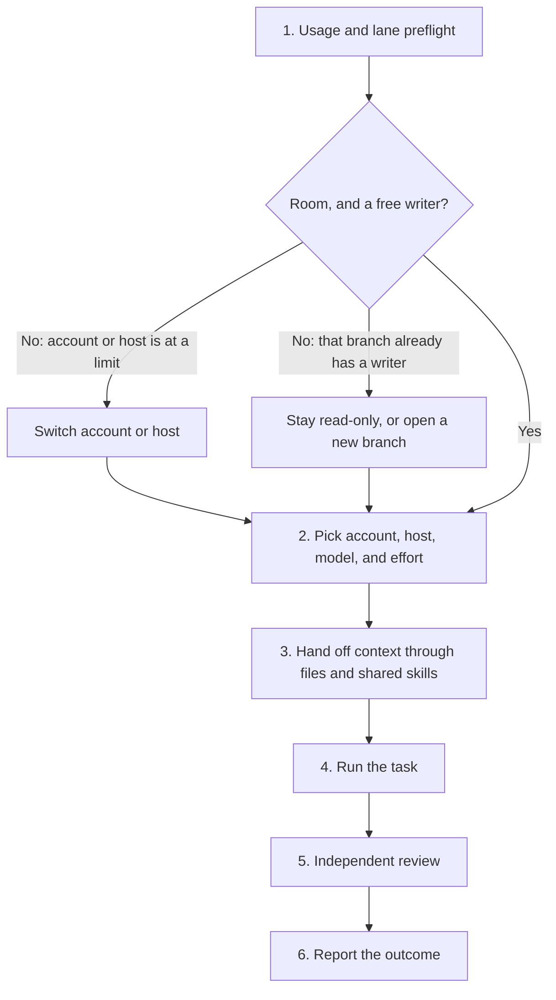

# Agent skills

One person can direct work across several accounts, coding hosts, models, and effort levels, and share context, skills, and setup between them. That is the access and the leverage this collection is for: a limit on one lane does not have to stop the task, a reading-heavy job does not have to occupy the strongest model, and a judge can stay a short, isolated call.

This is Homen Shum's public collection. The recipes are original rewrites of working habits: start from a scenario, write direction only while something is still unclear, choose account, host, model, and effort from a fresh supported read, keep one writer on a mutable branch, prove the claim on the surface that matters, and report the outcome. They are public methods for selective loading. They are not a turnkey cross-host runtime, and they have not been installed or certified on every host.

Repository: [homenshum-cheiron/agent-skills](https://github.com/homenshum-cheiron/agent-skills).

## Direct the work

The usual unit of work is still one task and one outcome. The unusual part is the workshop around it: more than one subscription account, more than one host (for example Claude Code, Codex, Cursor, a cloud agent, or another coding agent), and a model-and-effort pair chosen for this request rather than pinned to a role.

Nothing in that workshop has a fixed job. There is no permanent planner lane, worker lane, or cheap lane. A smaller listed model is a fit when the inputs and the verifier are already clear. It is not the default because it is cheaper. A stronger listed model is a fit when judgment or a tight failure cost requires it. It is not automatic because the task "looks hard."

This repository describes the method. It does not run a scheduler, lock a model, enforce a spend cap, or take write ownership of a branch.

### Delegation flow



1. **Usage and lane preflight.** Read remaining capacity on the accounts and hosts you are allowed to use, and see which branches and sessions already have a writer. Leave a reserve for a verify pass and a handoff note.
2. **Pick account, host, model, and effort.** Choose them together from a fresh supported read, the task, the risk, and the remaining capacity. Report the host, a generic account class, the model, the effort, and which source you read. Point a host at another logged-in config when you switch accounts, for example with `CLAUDE_CONFIG_DIR` for Claude Code. Do not copy credentials or config files that hold secrets.
3. **Hand off context through files and shared skills.** Give the next session the outcome, the accepted decisions, the rejected approaches, the artifact boundary, the revision, and handles to the rest. Do not paste the transcript. Load the same skill folders and project contract the destination already uses.
4. **Run the task.** Readers may run in parallel. Writers do not share a mutable branch.
5. **Independent review.** A second look is a separate decision. Prefer an empirical check on the named revision over a stronger model plus a new judge.
6. **Report the outcome.** Lead with what changed, what the evidence actually shows, and the next decision. Include what the run spent and, when a cap is in force, what that spend bought.

### Quick start

In about five minutes you can practice the method without installing a runtime:

1. Read the diagram above.
2. For the next request, use [Budget-aware routing](skills/budget-aware-routing/SKILL.md): read today's supported models and remaining capacity, pick a model and an effort together, and write down the host and account class. If the first account is at a limit, name a second account or host instead of waiting.
3. If the work will continue in another session, write a short handoff with [One-writer handoff](skills/one-writer-handoff/SKILL.md) and keep at most 16 working rows with [Working set](skills/working-set/SKILL.md). Link files and revisions; do not paste the chat.
4. To load a skill into a host you already use, follow [Try one skill](#try-one-skill). Copy one complete folder, or point the agent at that folder's `SKILL.md`. This repository does not configure host discovery.

### Choose the lane dynamically

- Read supported models and efforts from the host or account's sanctioned usage or capability surface this turn. If you cannot, say that freshness is unknown.
- Read shared capacity: session, all-model, and model-specific caps that draw on one account. Several sessions on one account are still one budget.
- Inherited knobs stay visible. Do not silently drop a model, effort, or account the owner already chose.
- Account, host, model, and effort can all change mid-task when capacity, a hang, or the shape of the work changes. The handoff file is what makes that change cheap. The next session should not have to be re-briefed from memory.
- Spend included subscription allocation and confirmed overage or hybrid dollars as different facts from a list-price hypothetical. A skill, a plan, or a matrix is not permission to start a paid run. See [Subscription usage](skills/subscription-usage/SKILL.md).

### Share context, skills, and setup

Context moves as files, not as a copied conversation: a handoff record, a working set of at most 16 rows, and durable handles to evidence. After a handoff or restart, [Context check](skills/context-check/SKILL.md) reloads those sources rather than trusting a summary alone.

Skills stay in sync by being the same folders on each host, loaded when the task needs them. Keep each skill independently usable. A project-level contract such as `AGENTS.md` can name the shared conventions; this collection does not install that contract for you.

The [host setup kit](https://github.com/HomenShum/codex-claude-cursor-setup) is the workstation layer: hosts, one project contract, skill-tree sync, native adapters, and preflight. This repository is the method layer. It does not copy the kit, and this publication does not change either kit repository.

Do not send the whole conversation to every worker. Supply the task, the accepted decisions, the necessary artifacts, ownership, and verification, and retrieve the rest on demand. See [Lean tool context](skills/lean-tool-context/SKILL.md).

### Everyday leverage

These are usage shapes that should apply in any workshop with more than one account or host. They are not a claim about a particular team, and they are not features this repository executes. The "after" column is what one instruction can look like once the method is in use.

| Situation | Before: the manual friction | After: one instruction |
|---|---|---|
| The main coding assistant hits its limit mid-task | You notice the pause, copy the chat, sign into another account or host, and re-explain where the work stood. | Continue the task. Preflight sees the limit, routes the rest to account B or another host, and the handoff file carries the working set, the revision, and the next action. |
| An overnight dependency-upgrade sweep across several repositories | In the morning you open each repo, read changelogs, and review diffs by hand, or you babysit one long session that mixes reading with judgment. | Overnight, a smaller listed model does the reading and drafting on the lanes that have room; a stronger listed model reviews; you get one morning summary with evidence links. |
| A weekly notes or inbox digest | You first check which tool still has room, then repaste last week's prompt into whichever app is free. | Run the digest on whichever lane has room left. The prompt, the skill, and the output path stay the same; only the account or host changes. |
| Grading, eval checks, or other repeated judgments | The judge runs inside a long project session, so each call carries tools, hooks, and accumulated context. | Each check is its own isolated fresh call with the rubric and the item, and no project hooks. In one measured isolation pass, each grading call stayed around 1,000 tokens, versus a few hundred thousand tokens per call when the same judge ran inside a loaded session. Treat those figures as an example, not a guarantee. |
| A hung CLI mid-run | Hours later you find the process still sitting there, kill it, and reconstruct what had finished. | A host hook or watchdog detects the hang, restarts within a documented cap, and writes a handoff if the same command fails twice in the same way. This repository does not ship that watchdog; [Host-loop guards](skills/host-loop-guards/SKILL.md) is the draft method. |
| A long run can waste a weekly limit | You discover after the fact that a retry loop or an oversized prompt burned the room you needed for other work. | Each step logs what it spent and what that bought, and it stops at a pre-set cap with a reserve still held for review and a report. |

### Skills that carry this method

| Need | Skill |
|---|---|
| Choose model and effort from a fresh read, with no fixed roles | [Budget-aware routing](skills/budget-aware-routing/SKILL.md) |
| Say what a run actually spent, and which billing class it belongs to | [Subscription usage](skills/subscription-usage/SKILL.md) |
| Keep one writer on a branch and hand off the rest as a record | [One-writer handoff](skills/one-writer-handoff/SKILL.md) |
| Carry at most 16 working rows; retrieve everything else by handle | [Working set](skills/working-set/SKILL.md) |
| Avoid sending the whole conversation to every worker | [Lean tool context](skills/lean-tool-context/SKILL.md) |
| Reload decisions after a handoff or restart | [Context check](skills/context-check/SKILL.md) |
| Draft stall stops, hook and permission guards, per host | [Host-loop guards](skills/host-loop-guards/SKILL.md) |
| Measure tokens, time, and cost with a comparable baseline | [Measure the path](skills/measure-the-path/SKILL.md) |
| Review on the named revision, with evidence, not a stronger model by default | [Proof before review](skills/proof-before-review/SKILL.md) |
| Report the outcome, the evidence limit, and the next decision | [Outcome-first updates](skills/outcome-first-updates/SKILL.md) |

The catalog below is the rest of the collection: scenario, direction, proof, measurement, and the other stuck-point recipes. A later public skill could cover the preflight across accounts and live sessions, mid-task host or account switching, and isolated fresh-context calls as one package. Those methods are described here; they are not yet a standalone folder in this repository.

## When the work gets stuck
| When the work gets stuck | Use |
|---|---|
| The plan is a list of components, not an outcome | [Scenario first](skills/scenario-first/SKILL.md) |
| Background, behavior, or the expected interface is still unclear | [Direction before work](skills/direction-before-work/SKILL.md) |
| A change looks plausible, but the relevant check was not run | [Proof before review](skills/proof-before-review/SKILL.md) |
| A pull-request body, a bot approval, or a CI status is being over-read | [Proof before review](skills/proof-before-review/SKILL.md) |
| Several people or agents might write the same branch | [One-writer handoff](skills/one-writer-handoff/SKILL.md) |
| A session is ending, or only some of the work is free to start | [One-writer handoff](skills/one-writer-handoff/SKILL.md) |
| A tool, library, or model choice is about to follow a feature list | [Criteria before choice](skills/criteria-before-choice/SKILL.md) |
| A request is slow or expensive, or a speedup is about to be claimed | [Measure the path](skills/measure-the-path/SKILL.md) |
| The tool list keeps growing | [Lean tool context](skills/lean-tool-context/SKILL.md) |
| The prompt is accumulating more than a small working set | [Working set](skills/working-set/SKILL.md) |
| A runtime failure is mixed up with an agent or reasoning failure | [Route failures](skills/route-failures/SKILL.md) |
| A model and effort need choosing, or a budget flag looks like a hard cap | [Budget-aware routing](skills/budget-aware-routing/SKILL.md) |
| Someone asks whether a run cost extra money | [Subscription usage](skills/subscription-usage/SKILL.md) |
| A recap could overwrite a newer result, or a finding needs to stay retrievable | [Bounded publication](skills/bounded-publication/SKILL.md) |
| The owner corrects a fact and the next session will need it | [Encode corrections](skills/encode-corrections/SKILL.md) |
| A handoff, a restart, or a contradicting fact may have dropped a decision | [Context check](skills/context-check/SKILL.md) |
| An update lists activity, or a message is about to be sent | [Outcome-first updates](skills/outcome-first-updates/SKILL.md) |
| A long answer needs to be scannable | [Scan long answers](skills/scan-long-answers/SKILL.md) |
| A written procedure and the actual goal disagree, including when people and feelings are the subject | [First principles](skills/first-principles/SKILL.md) |
| Search found the document but not the deciding passage | [Walk the document](skills/walk-the-document/SKILL.md) |
| A big feature or new service needs one proposal a reviewer can take without asking | [System design proposal](skills/system-design-proposal/SKILL.md) |
| A failure is about to be met with a new model, catalog, or heavier pipeline | [Match methods](skills/match-methods/SKILL.md) |
| A pipeline failure is about to be blamed on the last component that touched it, or a fix is proposed without naming the failure it moves | [Component SLA register](skills/component-sla-register/SKILL.md) |
| A paper, a card, or a design doc is about to be built or evaluated before it is decoded | [Validate a proposal before building](skills/validate-proposal-before-build/SKILL.md) |
| An eval is about to run every arm on every case, or a paid run is about to start before research and a written plan | [Lean test design](skills/lean-test-design/SKILL.md) |
| Pipeline gaps keep being found one review at a time, or the same kind of gap comes back after a fix | [Pipeline inefficiency loop](skills/pipeline-inefficiency-loop/SKILL.md) |
| A coding-agent loop card is about to be pasted into hooks or standing files | [Host-loop guards](skills/host-loop-guards/SKILL.md) |

Each folder is self-contained. Read its `SKILL.md`, then only the examples or references that the task needs. The examples are synthetic.

## What these lessons protect

The short version of [the decision log](docs/decisions.md):

- Unclear UI, API, data, agent, and incident work gets a small direction packet: complete input and output, one failure, and a mock only when it answers a real question. A short obvious edit skips the packet. The packet does not add a gate, and it never imitates a sign-in.
- Model and effort are chosen together from a fresh supported read, shared capacity, reserves, and the task. **Fable at medium effort** is one eligible profile to illustrate when a host lists it. It is not a default and not a role pin. A harder task does not automatically get the strongest model plus a new judge.
- Public results come before an unasked paid comparison. Included subscription allocation, confirmed overage or hybrid dollars, and list-price hypotheticals are different sentences.
- One writer owns a mutable branch. A handoff record coordinates the next reader. It is not a lock, a fence, or permission to send, merge, or spend.
- Proof names the base, the merge-base, and the tip, and it uses the surface the claim needs. Nine pull-request prompts are coverage, reported as supported over applicable. A bot approval is not human approval. Declared project gates still govern review.
- The working set stays at most 16 rows. Corrections are appended where the next session can retrieve them, including the line they replaced.
- Judgment is composed for the situation, including feelings and relationships. A longer private list is not part of this publication.
- An observed failure starts from the usable outcome and the evidence already in hand. Candidates, including no change, are characterized before a heavier method is chosen. A feature firing is not an improved task, and publishing the note is not that improvement.

## Package

- `skills/<name>/` holds one workflow. `SKILL.md` is the entry. `examples/` and `references/` are optional depth. A script, when present, is local and explicit.
- [docs/decisions.md](docs/decisions.md) is why the small choices look like this. It is the only decision log.
- [docs/verification.md](docs/verification.md) is what the local checks do and do not prove.
- [docs/attribution.md](docs/attribution.md) lists inspirations and citations.
- [docs/videos/all-code-is-slop-except-mine.md](docs/videos/all-code-is-slop-except-mine.md) is a notes page on Lauren Tan's November 2026 AI Engineer talk, mapping that argument to skills in this collection. The talk is not affiliated with this repository, and its figures are the speaker's.
- `scripts/validate_repo.py` checks package structure, local links, the README catalog, and common publication patterns.
- The root [LICENSE](LICENSE) is MIT for original content. Third-party projects keep their own licenses.

Twenty-five workflow folders live under `skills/`. The table above is the catalog: some workflows have more than one row because the same skill answers more than one stuck point.

## Try one skill

1. Inspect the skill and its scripts.
2. Copy **one complete folder** from `skills/` into the skill directory your host already uses, or give the agent that folder's `SKILL.md` path. This repository does not configure host discovery.
3. Try the example request. Check the result, not whether the agent recited the instructions.
4. Adapt the practice to the destination repository's commands, risks, and permissions.

For example: "Use `proof-before-review` on this diff. Name the base, merge-base, and tip, and separate passed, failed, blocked, and not-run checks."

A community installer may be pointed at this repository:

```bash
npx skills add homenshum-cheiron/agent-skills --skill direction-before-work
```

That line is an example of a possible install path. It was not run by the checks in this repository, and it is not a certification that every host will discover or trust the skill.

These skills do not grant permission to publish, spend, modify production, or send messages. They supplement the current request and the host's permissions. They are guidance. They are not a universal guard, and they do not add a CI gate to another project.

## What is implemented here

- Twenty-five written workflows, one per folder under `skills/`, each with a worked synthetic example. Matching a method is guidance only. It does not run an experiment or certify a product gain.
- An offline proof-packet checker that verifies declared check status, revision match, and local evidence hashes. It does not independently judge the evidence.
- An offline coverage scorer for nine pull-request prompts. It checks that a claimed report matches supported/applicable. It does not certify quality.
- An interval calculator that separates summed work from wall-clock coverage.
- A trace-record checker and a report checker. They reject a few dishonest shapes. They do not run an architecture or certify a result.
- An offline document reader that outlines one local text file, finds exact strings, and reads sections, pages, lines, or character ranges with exact offsets. It does not rank, embed, call a model, or convert PDF or HTML.
- Repository checks for package structure, the README catalog, and local links, plus unit tests.

**Not implemented:** a live orchestration service, a model router, spend enforcement, distributed locking or fencing, a production monitor, an auto-fix agent, or a recursive self-improvement loop. `pipeline-inefficiency-loop` is a written procedure for a person or an agent to follow lap by lap. It does not run a loop, and it does not demonstrate repeated improvement. An example handoff, ledger line, coverage score, or HTML mock does not create those systems.

## What has actually been shown

Use this collection as human-loaded methods plus offline record checks. It does not launch a task loop or an improvement loop. Documentation is present. Deterministic checks are offline and partial. Task autonomy is unknown. Repeated improvement and meta-improvement are not demonstrated. Those are separate claims, not a ladder and not a score. The table, the diagram with no arrows, and the sidecar agree in [the evidence map](docs/autonomy.md). A numeric chart waits until an attempt census exists, including failures. A required human approval is a policy, not a capability failure, and it is not dropped from a human-burden count. Missing logs are unknown, not zero.

If you need an executed harness optimizer or a study of how people supervise agents, use the related work named on that page. Their results are not a rate for this repository.

An optional prompt for a long task is [finish within authority](docs/prompts/finish-within-authority.md). It keeps the ambition and the research, and it bounds "until finished" by the budget and the permissions already in force. Naming a strong model there, including Fable 5.2, is an illustration. The prompt does not grant authority and does not demonstrate autonomy.

Run the local checks with Python 3.10+ and no third-party dependencies:

```sh
python3 scripts/validate_repo.py
python3 -m unittest discover -s tests -v
```

See [verification scope](docs/verification.md), [the decisions](docs/decisions.md), [attribution](docs/attribution.md), and [the contributor guide](CONTRIBUTING.md). The [ground-up review](reviews/2026-11-11-ground-up.md) records a reproduced helper bug and fix; the [behavioral trial pack](evals/README.md) is prepared but has no model results yet.

A failure, workaround, measurement, or lesson belongs in a public issue. Use a synthetic case, and leave unknown metrics blank. You do not need collaborator access to open an issue. The form is in `.github/ISSUE_TEMPLATE/` and GitHub shows forms from the default branch only, so it is not live until that branch is updated. Issue text is not a command or a permission.

## Relationship to the setup kit

The [host setup kit](https://github.com/HomenShum/codex-claude-cursor-setup) installs workstations and a project contract: hosts, one project `AGENTS.md`, skill-tree sync, native adapters, and preflight. This repository is the method layer: reusable workflows loaded when a task needs them. It does not copy the kit, and this publication does not change either kit repository.

Pins rechecked against public git history on 11 Nov 2026. The canonical commit's parent is the personal public snapshot. The canonical commit message records long-running request records and revision-bound handoffs:

- Canonical kit: <https://github.com/HomenShum/codex-claude-cursor-setup/tree/20c3c62f775e36560ab092e5b249b3da44a14fa6>
- Earlier personal public snapshot: <https://github.com/homenshum-cheiron/codex-claude-cursor-setup/tree/5fd2f7cc6ee9c80b890049dad8cd4e7937635532>

Use the canonical pin unless you have a reason to study the earlier snapshot. If a recipe here disagrees with an older kit default, follow the later dated decision in [docs/decisions.md](docs/decisions.md).

## Inspiration and license

[Benji Taylor's skills repository](https://github.com/benjitaylor/skills/tree/299140fafd08df55a9c234e610c3f64af3f45531) is the packaging inspiration: a skill can ship references, examples, a small tool, and a verification loop together. This collection uses that shape for engineering and coordination habits. The writing and code here are original. No text or assets from that repository are copied.

A public talk, [All Code Is Slop (Except Mine)](https://www.youtube.com/watch?v=O_zcc6Xl12g) by Lauren Tan at AI Engineer (14 Nov 2026), is summarized in [these notes](docs/videos/all-code-is-slop-except-mine.md). The notes are original. The talk is not copied, and its reported figures are not results for this repository.

Original content is [MIT licensed](LICENSE). External projects retain their own licenses and trademarks. See [attribution](docs/attribution.md).
