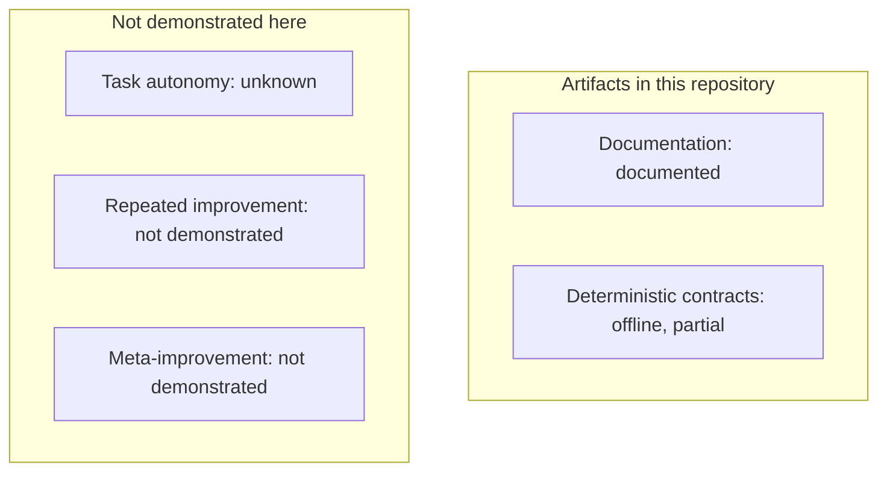

# What this collection has shown

This is a qualitative evidence map for [homenshum-cheiron/agent-skills](https://github.com/homenshum-cheiron/agent-skills) at `a493e6374a7b6c31c5baafbbe0224ba6d9c4a56a`. It is not a score, not a scale of autonomy, and not a released recursive self-improvement system. The same claims are in [autonomy-map.json](autonomy-map.json). A checker can reject a numeric chart or a diagram edge that the record does not support. Passing that checker does not prove autonomy.

The five rows are separate claims. They are not steps you must climb, and they are not a universal scientific scale.

| Claim | Status here | Humans still in the loop | Missing before a stronger claim |
|---|---|---|---|
| Workflow documentation | Documented | Choosing a skill and adapting it to local permissions | Host follow-through |
| Deterministic contracts | Offline, partial | Deciding whether a green check is about the right claim | A product result or a permission |
| Task autonomy inside a stated permission box | Unknown | Unknown. Missing logs are not zero | Attempts, including fails, timeouts, and abstentions, plus intervention records |
| Repeated improvement of a frozen target | Not demonstrated | Authorization to test, adopt, or roll back | A published promotion lineage with held-out confirmation |
| Improving the improvement process | Not demonstrated | Authorization and an evaluation of that meta-change | A mechanism and an effect on a later improvement, not a label |

No arrow is drawn. Placement is not an order, not a reachable path, and not a color code. Task autonomy is unknown. Repeated improvement and meta-improvement are not demonstrated.

## Where people still intervene

Count these separately when a log exists: the initial specification, clarification, a required policy approval, and rescue after something goes wrong. Also split human active time from wait time, and split task cost from critical-path wall time. A required approval is a policy, not a capability failure, and it stays in the human-burden count. It is not dropped because the policy was followed.

Two measures stay distinct. One is unassisted completion inside a stated permission set, with a quality, evidence, and permission guard. The other is completely human-free end-to-end work. Neither is published here, because there is no attempt census. Failures, timeouts, and abstentions belong in the denominator. A correct abstention can be a safe policy outcome and still not a finished task. If the log is missing, the count is unknown, not zero.

A later numeric chart needs those denominators, pinned task and permission versions, and held-out repeats. Until then this page stays qualitative.

## How close is a self-improving harness?

Close enough to describe a careful loop and to check records offline. Not close enough to claim the loop ran or improved itself. The sketch in [loops.md](../skills/match-methods/references/loops.md) is an unvalidated hypothesis. This repository does not launch it.

A prompt edit can be one ingredient of a later improvement. Calling that recursive self-improvement needs a shown mechanism and an effect on a later improvement, not the name alone. That evidence is not in this collection. There is no date by which it is expected.

## Related work

Read on 11 Nov 2026. Their results stay in their settings. Overlap is a shared idea, not a claim that another project lacks something, and not an estimate of success here.

| Work | What it executes | Use it when | This collection |
|---|---|---|---|
| [Harness²](https://arxiv.org/abs/2610.14224), code at [google-research/harness2](https://github.com/google-research/harness2) commit `6868817518876de8fd170c6a8354daca273b6191` (Apache-2.0) | The README at that commit describes task-level Propose–Probe–Compose without ground-truth verifiers, and a second level that keeps lessons for later harness edits, with model weights fixed | You need an executed, label-free harness editor on a task stream | Writes the two-level idea and does not run it |
| [Self-Harness](https://arxiv.org/abs/2606.09498) | The abstract describes weakness mining, harness proposals, and validation by regression testing, and reports held-in and held-out pass rates on its benchmarks | You can run a verifier on fixed splits and want an executed propose-and-validate lineage | States similar gates in prose and has no such lineage |
| [Measuring agent autonomy](https://www.anthropic.com/research/measuring-agent-autonomy) (Anthropic, 18 Feb 2026) | An observational study of supervision in their products, including auto-approve, interrupts, and clarification | The question is how people actually grant and withdraw autonomy | Does not convert their observations into a rate for this repo |

Choose those projects for an executed benchmark optimizer or an observational protocol. Choose this collection for human-loaded methods and offline record checks. What would move a row here is this collection's own log: eligible attempts including failures, intervention types, and, for repeated improvement, a frozen target with held-out confirmation and an authorization record.

## Ordinary situations behind the map

These are generic failure shapes. They are not evidence that other methods never meet them.

- A tool result omits an official URL or authority marker, so a later step may detour. The first repair may be the result shape.
- First-token time was never recorded, or one generation's tokens are counted twice. A speed or spend claim is then uninterpretable. Missing is not zero.
- A blocked fetch can be cheaper than a successful read and still not improve the answer.
- Reading a document again can be how the deciding passage appears. Call it waste only after checking whether new required evidence showed up.
- A report or a judge verdict is not permission to change live behavior.

The machine record is [autonomy-map.json](autonomy-map.json). Check it with `python3 scripts/check_autonomy_map.py docs/autonomy-map.json`.
