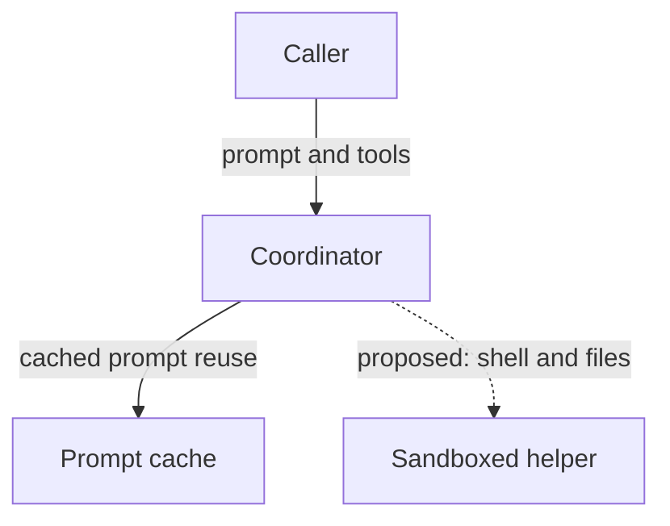

# Findings, artifacts and evidence

Use this reference when the entrypoint's findings, artifact or evidence sections apply. The page template and the worked example stay the companions for notes cards and engineering write-ups.

## Findings: Before, GAP, FIX PLAN, After

- One line per finding in a chat post or card. Details live in the linked doc or artifact, not the post.
- Directly under each finding, nest a **GAP** item (what is missing or broken, with the root cause if known), and under it a **FIX PLAN** sub-bullet (owner, steps, and the proof test that shows it worked).
- Show each finding as **Before** (today's state, grounded in the current code at a named commit and the latest data, with links), then **GAP**, then **FIX PLAN**, then **After** (the proposed state, labeled proposed or target until a rerun proves it).
- Delegate fixes right away once the user approves. Do not leave measurable or fixable gaps sitting as pending tasks.
- Before writing a FIX PLAN, check it against the latest product spec or contract (main, not only the last release) and the newest decisions in chat. A newer spec overrides an older chat ruling; say which one wins and link both.
- Post order: finish the fix, get CI green, self-review, and put proofs in the pull request body before any review ask or fix announcement. A summary post is shown to the user as a draft first.

## Visual artifact with system design diagrams

When findings span several owners or components, or the user asks for an artifact like the team's, build one self-contained page (a single HTML file or the team's usual artifact tool) in addition to the short post.

1. **Find the team's existing artifacts first.** Search the team's existing artifacts as style references (published pages, HTML reports, or the team's usual artifact tool) and collect several from different teammates. Match their layout, tone and density. If a reference can't be loaded, say so and name the fallback layout used.
2. **Structure:** a BLUF header, an owner index, then one section per owner. Each finding inside uses Before, GAP, FIX PLAN, After. Keep a sources panel with every link.
3. **System design diagrams** wherever a flow or architecture is involved: the current architecture (who calls whom), routing or tier layout, data and cache paths, and the Before-vs-After of each fix. Rules: sequential steps on separate levels, every arrow labeled with what is handed off, one core component per node, proposed edges dashed, and keep it simple. Use Mermaid or inline SVG so it renders offline.
4. **Parallelize:** split diagram drawing, code-claim checks and section writing across parallel workers, then have a fresh reviewer read the whole page last.
5. **Self-check before delivery:** every link opens, every claim carries a verdict, first-mention labels are present, and a secrets scan is clean. Strip anything internal before it goes anywhere public.
6. The chat post stays short (one line per finding plus GAP and FIX PLAN) and links the artifact.

Diagram sketch (synthetic):

The dashed edge is the proposed After, not the current path, until a rerun proves it.

## Evidence standard

A note, card, pull request body or post is not ready until every factual sentence has been checked against its source. Wording that sounds right is not evidence.

1. **Split into claims.** Break the draft into one claim per sentence (who owns what, who said what, dates, numbers, how the code behaves, customer requirements, decisions).
2. **Search every system the user works in, not a fixed list.** Setups differ: one team lives in chat, docs and tickets; another in email, drive, calendars, meeting transcripts, a CRM, a code host, observability and eval traces, or local files. First list which systems this user actually uses (connected tools, memory, and the sources named in the draft), then search each one for every claim. Look for the newest message or decision too, since a later thread can overturn an earlier doc.
3. **Give each claim one verdict:** verified (a source says it), wrong (a source says otherwise; fix it), unverified (no source found; say so in the text or cut it), or inference (our own reading; label it "our read"). Never upgrade an inference or a guess to a fact, and never call a sourced requirement an "assumption".
4. **Attach the proof.** Each verified claim carries a link a reader can open: a chat permalink, doc or ticket URL, commit or file:line at a named commit, trace or CI run link. Local workstation paths are not shareable; upload the artifact and link it, or drop the claim.
5. **Pin who and when.** Quote or paraphrase the person with their name and date. Don't merge two people's statements, and don't attribute a phrase to a doc that only appears in a chat summary.
6. **Keep an audit file.** Save a per-sentence table (claim, verdict, source link, correction) next to the draft, and list which systems were searched and which could not be reached. Mention unreachable systems in the report so the reader knows the gap.
7. **Re-check after every edit.** A rewrite reopens the check for the sentences it touched.

If the data to compute an impact number already exists, compute it and put the number in. Do not leave a computable figure as a to-do.

Label every named company and person the first time they appear, e.g. "Acme Robotics (company) lunch with Jordan Lee (Staff Engineer)". Take roles from a real source (the company site, a speaker page, or a public profile) and treat each label as a claim under this standard; write "(role unverified)" rather than guessing.
