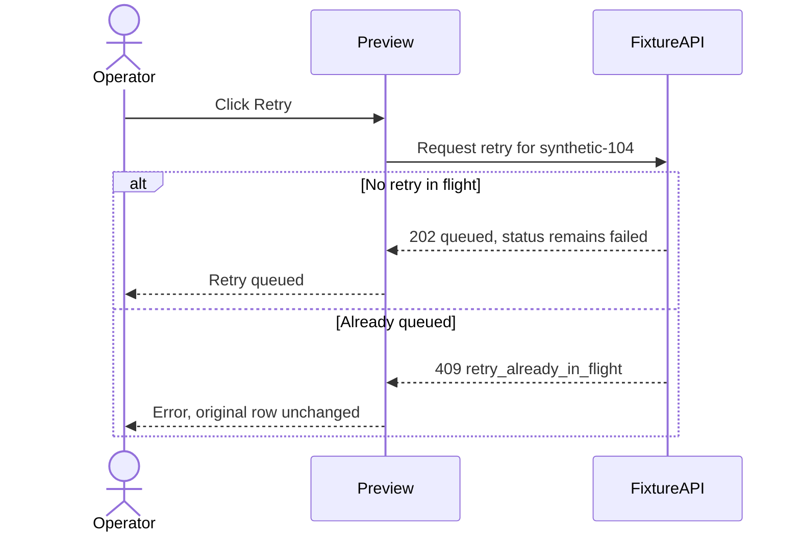

# Example: weekly digest retry (synthetic)

Invented teaching data, not a production incident. The question is why a weekly digest failed and how one retry can be queued without sending mail.

- Current: a static Failed badge.
- Desired: explain the failure, queue a retry once, and reject a second queue attempt.
- Constraint: the preview must not send mail.
- Acceptance: queued is not sent; a duplicate enqueue is rejected; errors leave the original state unchanged.
- Open: the vendor daily retry limit is not established.

Happy input:

```json
{"digest_id":"synthetic-104","status":"failed","last_error":"smtp_timeout","retry_state":"none","retry_requested":true}
```

Processing: validate the failed status and the absence of an in-flight retry; create one queue entry in the fixture simulation; send no message. Expected: HTTP 202.

```json
{"digest_id":"synthetic-104","status":"failed","retry_state":"queued","side_effect":"one_queue_entry_no_send"}
```

Failure input, already queued:

```json
{"digest_id":"synthetic-104","status":"failed","retry_state":"queued","retry_requested":true}
```

Processing: reject the duplicate; create no queue entry; send no message. Expected: HTTP 409.

```json
{"digest_id":"synthetic-104","status":"failed","error":"retry_already_in_flight","side_effect":"none"}
```

The sequence is useful because duplicate-retry behavior is the unclear part:



The [static click-through mock](retry-states.html) shows Failed, Loading, Queued, the duplicate error, an empty list, and permission denied. It demonstrates keyboard focus and labels. It does not send mail and it has no sign-in screen. A separate architecture diagram answers nothing further, so it is omitted. If the handler shape is unclear, show only the guard, the enqueue, and the response, not a speculative full patch.

This packet is direction. It is not a test run on a tip, and it does not prove a vendor limit.
