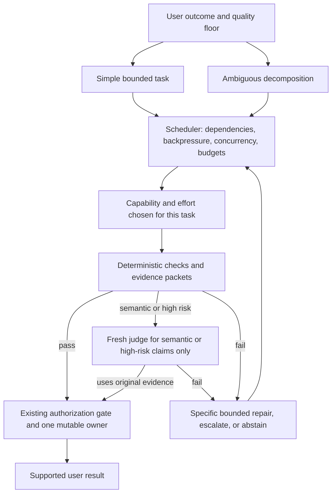
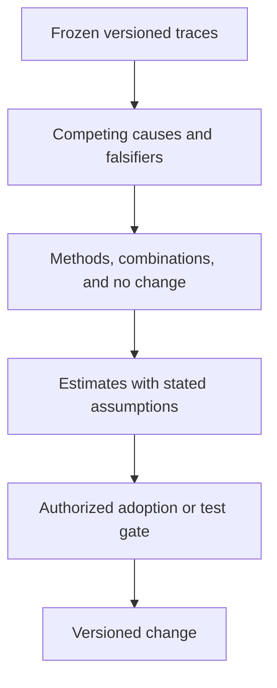

# Two linked loops (unvalidated hypothesis)

These diagrams are an architecture hypothesis for chat-native investigation and improvement. They are not a required process, not a running system, and not evidence that autonomous operation works. This repository does not launch either loop. Roles are temporary seats. There is no fixed model or role map. A name such as Fable is an illustration only when a fresh host listing includes it. It is not a default.

A failed check does not fall through to accept. A budget stops the loop. Human approval is not automatic acceptance. Missing data is not repaired by calling a stronger model again. A judge reads the original evidence, not only a worker summary. A recommendation or a verdict is never permission. The offline loop does not start a live experiment or grant itself a permission. The only path from a versioned change to live behavior is an authorization gate that already exists outside this note.

A cheaper worker is preferable only when the total of planner, workers, checks, judge, retries, and tool use, per supported result, beats the direct baseline at the quality floor. Critical-path latency stays separate from summed work. API spend stays separate from subscription usage. Judge and worker errors can be correlated. Report false accepts, false rejects, and any manual calibration. Do not treat those rates as known until they are measured.

## Task runtime

Instrument every stage that this hypothesis names. Unavailable data stays missing. Scoped context, a versioned source, and cache identity travel with the worker. The scheduler's budget is a stop, not a suggestion.

## Offline loop

Estimates are not measurements. Overlapping candidate benefits are not added. No automatic live experiment leaves this loop.
