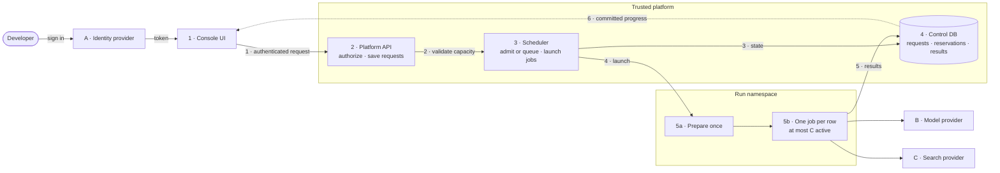

# System design proposal

Write the proposal before the code when a change crosses services, owners, or budgets. The reader should be able to explain what will exist, what will not, how data moves, what it costs, and how each phase is proven, without reading the code or asking you. Prefer tables, diagrams, and worked numbers to prose.

Skip it for a one-component fix with an obvious check, and say so.

## Sections, in this order

1. **Header.** Title as `Thing — property, property, property`. Status (Proposed / Accepted / Superseded, and what is built versus only designed), date, revision (what this revision consolidates), scope (in and explicitly out), and any reference document whose shape you borrowed but whose choices are not requirements.
2. **What this is.** The concrete workflows it enables, numbered. Then the non-negotiable properties as bold one-liners. End with a boundary: "This is a target and delta, not a claim that anything is deployed. Numbers are illustrative unless marked measured."
3. **Current state and evidence.** Pinned revisions (commit, version, date) for everything audited. A repository or owner table: name, responsibility. Then "what exists and what it does not establish": each foundation and the claim it does not prove.
4. **Gap table.** Requirement × available foundation or limitation × target change. One row per requirement.
5. **Target architecture.** The diagram (below), a text topology tree, and the contracts: resources per unit, accepted differences from the reference environment (table), data ownership, and what is shared versus isolated.
6. **Flows.** One arrow chain per workflow (`request → validate → reserve → run → persist → report`) with its named states and failure states. Then edge cases: retries, races, late writes, duplicates, partial failure, cleanup.
7. **Budgets and limits.** Formulas first, then one worked calculation table, labeled illustrative or measured. Name the tightest constraint and show the arithmetic at the boundary (fits N, N+1 does not).
8. **Security, permissions, retention.** Who may do what, where it is enforced, what never leaves, and the ordered delete path with "done only when verified".
9. **Implementation changes.** Work package × repository or seam × required delta. Paths are seams, not claims that the API exists.
10. **End-to-end examples.** One arrow chain per main workflow, start to cleanup.
11. **Phased roadmap.** Phase × deliverable × acceptance gate. Each gate is observable.
12. **Verification.** Evidence required before rollout, and what existing checks do not qualify.
13. **Open decisions.** Numbered, each with what proof would settle it.
14. **What stays the same.**
15. **Artifacts and sources.** File table and links. A completion boundary: what is delivered (docs, prototypes) versus not (code, infrastructure, live measurement).

## The diagram

One diagram that answers "what talks to what, who owns it, and where data rests". Title it with the date and "design for review", and say it is a target, not deployed resources.

- Number internal components and letter external providers. Give each box two or three responsibility lines.
- Group boxes into zones: trust boundary, per-tenant or per-run namespaces, shared services.
- Number the important edges and label them with the payload or command.
- Use a legend: solid = commands and data, dashed = identity or state, and say which components are new.
- Add short side panels: new responsibilities, batching and ownership, reading guide.

## Socratic self-review before sharing

- Which exact model, pipeline, service, and owner? Replace every "the system" or "the model" with a name and version.
- What is the real volume per day or year, and what does it cost at base and high volume? Show the multiplication. Cheaper than what baseline?
- Which numbers are measured, and from which run or revision? Which are illustrative?
- What does the evidence not establish? Is anything described as deployed that is only designed?
- Which edge case would a reviewer find first? Is it in the flow?
- What is the tightest limit, and what happens at N+1?
- Who acts next, on what, by when? Every phase gate has an owner and an observable check.
- Is every claim stamped with a revision and date so a later reader can tell it is stale?

## Boundaries

This skill writes a document. It does not approve the design, grant permissions, start spend, or create infrastructure. Keep the code-level spec and scenario tests where the codebase keeps them; this proposal sits on top for humans. See the [synthetic worked example](examples/worked.md).
