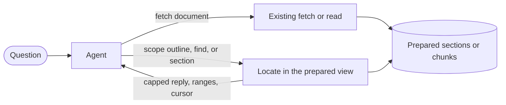

# Design note: adding a document walk to a fetch or read tool

This is a public, generalized design note. It does not describe a private product, a private evaluation, or a measured production result. The method in [the parent skill](../SKILL.md) already covers how a person or an agent should walk a long document once it has been found. Use this note when you are considering the same behavior *inside* an existing document-fetch or document-read tool.

Examples in this folder are synthetic. This note is a design target, not a claim that a tool already behaves this way, and not a license to spend.

## The problem

Search or a first fetch often locates the right document and then misses the deciding passage. Typical failure modes:

- The tool ranks or returns only a prefix of a long document, so a passage later in the file is never read.
- A follow-up call re-searches the same document with new wording instead of reading a named place.
- An uncapped reply floods the context, and a later quote cannot be cited back to a range.

## Non-negotiables

- **No new tool and no new store** if an existing fetch or read tool can take a scope argument.
- **Read by place** after the document is known: outline, then exact-string find, then the smallest enclosing section, then widen or narrow. Do not start a new keyword search of the same document.
- **Bounded replies.** Every reply has a cap, says where it stopped, and can continue from a cursor.
- **Citable spans.** Quotes come from a read, with section, page, or chunk ranges.
- **Same-version comparison.** If you later measure walk versus no-walk, hold the document version, the model, and the grader fixed. A single unpaired run is a probe, not a decision.

## Target shape (illustrative)

1. The agent calls the existing fetch or read tool with a URL or document id.
2. The tool prepares a stable, chunked or sectioned view (outline, pages, text units) and returns a capped prefix plus a way to continue.
3. Later calls pass a scope such as `outline`, `section:…`, `page:…`, or `find:<exact string>`, plus an optional cursor.
4. Each reply stays under a budget, includes ranges, and names the next cursor when more remains.

A mermaid sketch of that shape:

Solid arrows are data the agent sees. This is a target, not a deployed architecture.

## What this note does not do

- It does not add a second public skill. The reading method stays in `walk-the-document`.
- It does not publish private repository paths, private evaluations, cost tables, or internal names.
- It does not treat an offline locator score as an end-to-end win, and it does not treat a cap on reply size as proof that the agent found the passage.
- It grants no permission to build, spend, or change a production tool.

## Verification, if you later build this

Keep documentation of the method, an offline check of the locator, and an end-to-end paired comparison as separate claims. Unknown is not zero. A required human approval stays a human step, not a capability failure.
